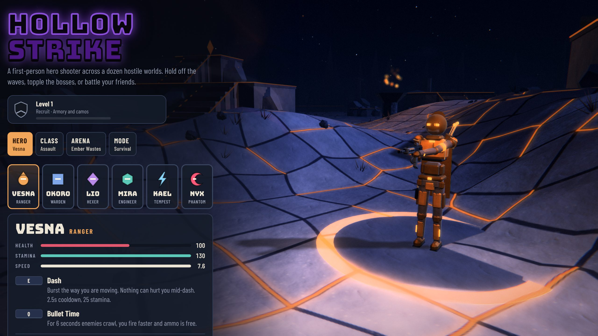

# Hollowstrike

A first-person hero shooter across a dozen hostile worlds. Hold off the waves, topple the bosses, or battle your friends.

**[▶ Play Hollowstrike in your browser](https://ksb-killer.github.io/hollowstrike/)**

## Play

Click the link above. There's nothing to install. The whole game is one file, `index.html`, so you can also download it and open it in Chrome, Edge, Firefox or Safari. It needs an internet connection the first time to load the 3D engine and fonts.

Works with mouse and keyboard, a gamepad, or touch controls on phones and tablets.

## What's in it

- **Six heroes**, each with their own skill and ultimate, plus seven classes to pair them with
- **Survival runs:** fight through waves, buy gear from the Ember Merchant between waves, and take on bosses. Boss Rush, Onslaught and Hardcore modes too
- **Versus** against AI bots: Free-for-All, Team Deathmatch, Gun Game, Hardpoint, Kill Confirmed and One Shot
- **Operations:** a campaign of missions
- **Parkour:** ten courses to race through
- **Split-screen** for up to four players on one screen, co-op or versus
- **Armory and Records:** level up, unlock camos, and track your best runs

## Controls

| Action | Key |
| --- | --- |
| Move | W A S D |
| Look | Mouse |
| Fire / Aim | Left click / Right click |
| Jump | Space |
| Sprint | Left Shift |
| Slide | C |
| Reload | R |
| Pick up | F |
| Hero skill / Ultimate | E / Q |
| Grenade / Medkit / Sentry | G / H / T |
| Quick melee | V |
| Switch weapon | 1–4, mouse wheel, or X / Z |
| Use killstreak | 5 |
| Shop (between waves) | B |
| Pause | Esc or P |

Every key can be changed in **Settings**.

## Notes

- **Online play** uses a feature that only exists inside Claude, so it only works when the game is opened in Claude. Everywhere else, the Online screen says it isn't available. Every other mode works anywhere, split-screen included.
- **Progress** (settings, unlocks, records) is saved in your browser, so it stays on the device and browser you play on.
- Built with [three.js](https://threejs.org/) r128 (loaded from cdnjs) and the Bungee and Barlow Condensed fonts from Google Fonts.
